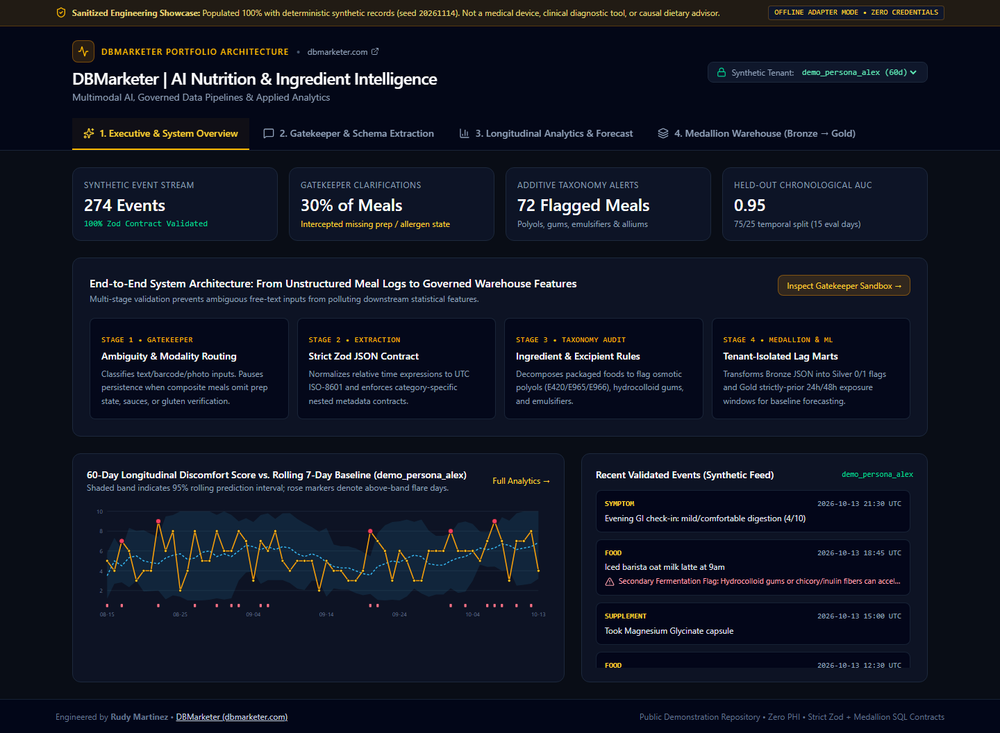
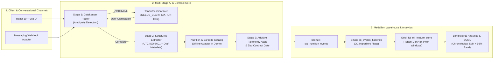
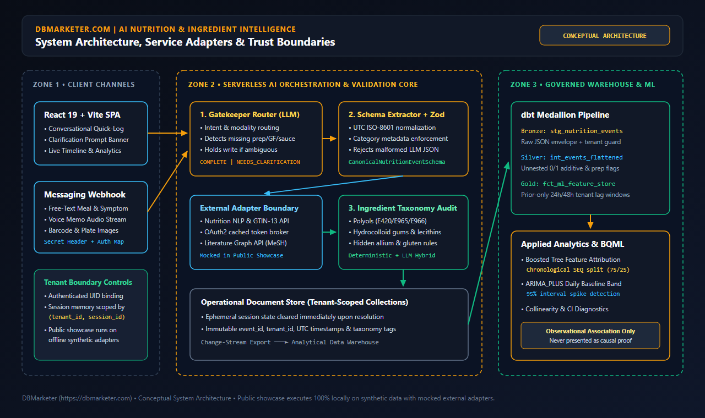
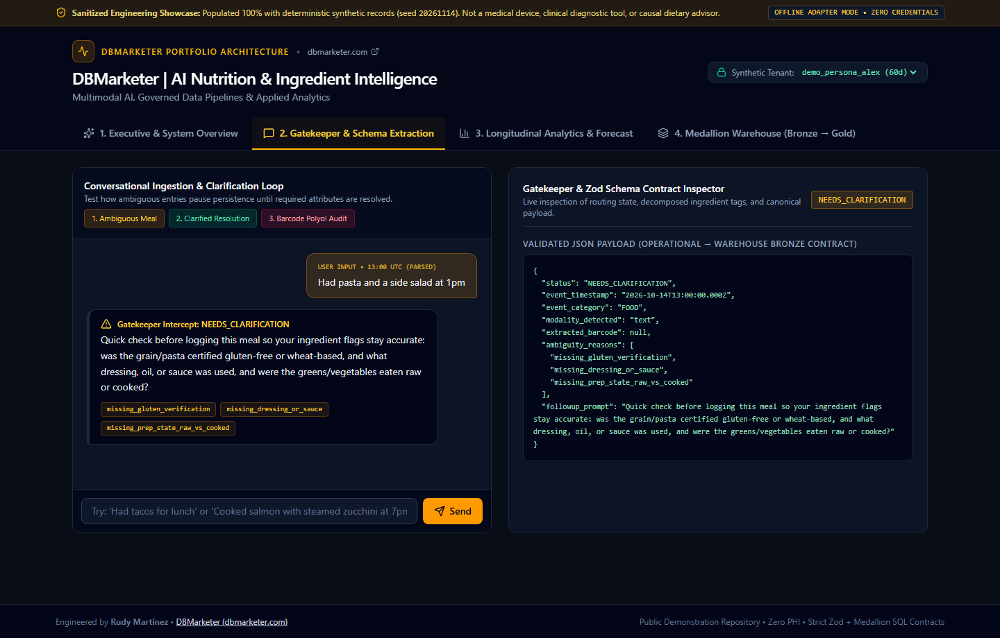
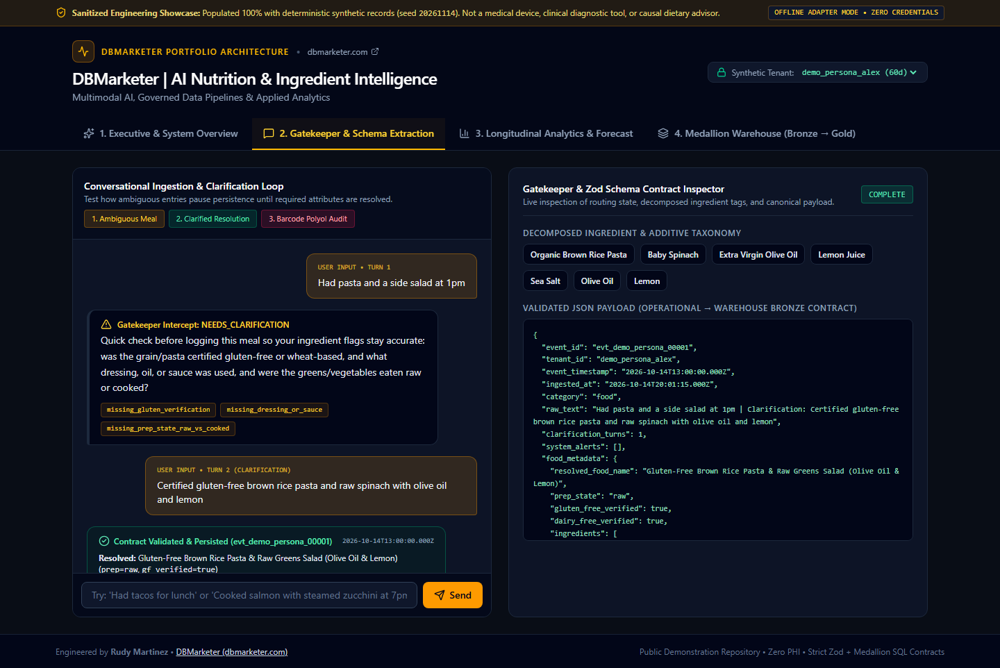
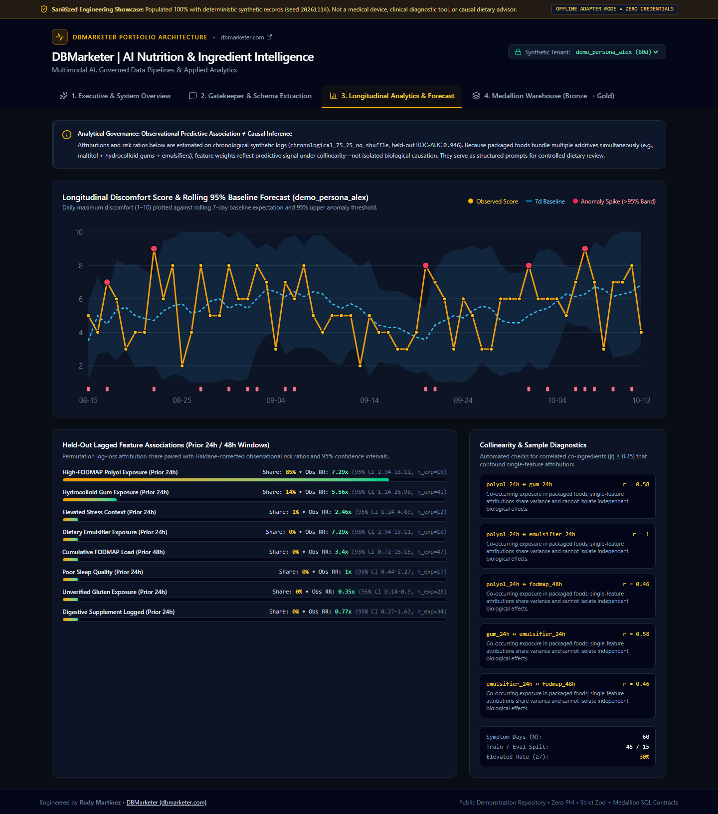

<div align="center">

# AI Nutrition & Ingredient Intelligence

### *A privacy-safe, synthetic-data demonstration of multimodal AI orchestration, governed analytics pipelines, and predictive modeling.*

**`React` · `Gemini` · `BigQuery ML` · `dbt` · `Applied Analytics`**

**By Database Marketer | [dbmarketer.com](https://dbmarketer.com)**

[](https://dbmarketer.com/case-studies/ai-nutrition-intelligence)
[](https://nodejs.org)
[](tests/)
[-f59e0b?style=for-the-badge)](LICENSE)

**[Primary Case Study (`dbmarketer.com`)](https://dbmarketer.com/case-studies/ai-nutrition-intelligence)** · **[Executive Narrative (`/work`)](https://dbmarketer.com/work/ai-nutrition-intelligence)** · **[Architecture Deep Dive (`/engineering`)](https://dbmarketer.com/engineering/ai-nutrition-intelligence-architecture)** · **[Local Demo Guide](DEMO_GUIDE.md)** · **[Technical Architecture](TECHNICAL_ARCHITECTURE.md)** · **[Security & Privacy](SECURITY_AND_PRIVACY.md)** · **[Package License](LICENSE)**

</div>

---

> **Start With the Primary Case Study:** You do not need to dig through source code to understand why this system was built or the analytical decisions behind it. Read the full human and product narrative first at **[dbmarketer.com/case-studies/ai-nutrition-intelligence](https://dbmarketer.com/case-studies/ai-nutrition-intelligence)**, then use this package to inspect and run the supporting engineering, data contracts, SQL transformations, and validation tests locally.
>
> **Package License Notice (Source-Available - Not Apache 2.0):** Although other utilities in the parent `dbmarketer` repository use Apache 2.0, this `ai-nutrition-intelligence/` package is **source-available** (not OSI open-source) and is governed by [`ai-nutrition-intelligence/LICENSE`](LICENSE). Prospective employers, hiring teams, organizations evaluating DBMarketer's services, and engineers are expressly permitted to view, clone, install, test, and run this demonstration locally for internal nonproduction evaluation and study. Commercial production use and redistribution outside GitHub's native platform features require separate written permission from Database Marketer.
>
> **Non-Clinical Demonstration Notice:** This package is a **sanitized software engineering and applied analytics demonstration** populated exclusively with deterministic synthetic records (`seed = 20261114`). It is **not** a medical device, diagnostic service, or clinical recommendation system. Model feature shares and risk ratios reflect observational associations on synthetic timelines and must never be interpreted as causal or clinical findings.

---

## 1. Why This Project Exists: From a Human Problem to Decision-Ready Analytics

This project began at home with a personal goal: helping someone I care about understand how everyday meals, ingredient quality, food preparation, sleep, movement, and daily routines relate to how she feels - and organizing weeks of lived experience into clearer questions for conversations with healthcare professionals.

Building a machine learning model is rarely the hardest part of an applied analytics problem. Useful analytical products depend on four connected leadership decisions:

1. **Frame an Ambiguous Human Problem Around Decisions:** Everyday life does not arrive as clean rows in a warehouse. Rigid tracking forms cause people to quit within days, while naive AI chat loggers accept vague notes (*"Had pasta and a side salad at 1pm"*) that silently omit gluten status, dressings, preparation state, and hidden packaged additives. The product goal was to organize better questions for human review, not to automate diagnoses.
2. **Establish Trustworthy Data Before Storage:** Rather than trying to rescue noisy free text downstream in SQL, I worked backward from the analytical feature matrix (`fct_ml_feature_store`). When an entry omits context that would flip a downstream exposure flag, a conversational **Gatekeeper** pauses persistence and asks one brief follow-up question (`0` partial rows written in tests), enforced end-to-end by shared `Zod` schemas.
3. **Select Appropriate Longitudinal Methods Without Leakage:** Self-tracked longitudinal cohorts have modest sample sizes and strong serial autocorrelation across `24h` and `48h` exposure windows. Rolling SQL windows terminate strictly at `1 PRECEDING` (`PARTITION BY tenant_id`), models evaluate on chronological splits (`75/25` `SEQ`) rather than leaky random folds, shallow regularized boosted trees prevent overfitting, and rolling baseline intervals (`ARIMA_PLUS` / 7-day bands) anchor daily scores against baseline variation.
4. **Communicate Evidence, Collinearity & Uncertainty Honestly:** Commercial "low-sugar" foods frequently bundle sugar polyols (`Maltitol` E965, `Lactitol` E966), gums, and emulsifiers in the same item. Tree splits can assign 85%+ of permutation gain to whichever correlated additive splits first while assigning 0% to a co-occurring additive with the exact same univariate risk ratio. Our analytical layer computes pairwise feature correlations (`abs(r) >= 0.35`), attaches Haldane-corrected confidence intervals and sample counts, and surfaces explicit collinearity warnings so associations are never misread as single-ingredient causes.


*Synthetic Demo Screenshot - Overview workbench for fictional persona `demo_persona_alex` across 60 simulated days (`seed = 20261114`).*

---

## 2. What Is Real, What Is Mocked, and What Uses Synthetic Data

To keep the private production application and household records completely private while giving hiring teams, prospective clients, and engineers a genuinely runnable demonstration, this package separates real executable logic from offline service adapters and synthetic data:

| Capability Layer | Private Production System (Retained Privately) | What Runs in This Public Package (`100% Zero-Credential`) | Classification |
| :--- | :--- | :--- | :--- |
| **React 19 Workbench UI** | React 19, Vite, Tailwind CSS v4 on Firebase Hosting | Standalone React 19, Vite 8, Tailwind CSS v4 interactive workbench (`src/ui/App.jsx`) | **Real Runnable UI** |
| **Conversational State Machine & Tenant Guard** | Cloud Functions v2 multi-turn session state & auth checks | Executable `ConversationalIngestionPipeline` (`NEEDS_CLARIFICATION` hold + `TenantIsolationError` enforcement) | **Real Runnable Code** |
| **Schema & Additive Taxonomy Contracts** | `@google/genai` JSON schemas + FDA/Monash additive rules | Executable `Zod` contracts (`src/contracts/eventSchema.js`) + deterministic E-number/polyol/gum/emulsifier classifier (`src/taxonomy/dietaryRules.js`) | **Real Runnable Code** |
| **LLM & Food/Barcode APIs** | Live Google Gemini API, Telegram Webhook API, FatSecret OAuth 2.0 API | Deterministic `MockGeminiOrchestrator` & `MockNutritionCatalogAdapter` (`src/adapters/mockExternalServices.js`) | **Mocked Offline Adapters** |
| **Academic Literature Retrieval** | Live Semantic Scholar Graph API (`runActiveResearch`) | Documented contract boundary (`LiteratureSynthesisInterface`); live calls throw `OfflineDemoBoundaryError` so mock citations are never fabricated | **Documented Interface Only** |
| **Medallion Warehouse (`Bronze -> Silver -> Gold`)** | Firestore-to-BigQuery export + dbt Core SQL marts | Sanitized BigQuery dbt SQL (`warehouse/dbt_reference/`) + real in-memory `node:sqlite` window-SQL runner verified at `410/410` row parity (`src/warehouse/`) | **Real SQL + Reference dbt** |
| **Longitudinal ML & Evaluation** | BigQuery ML (`BOOSTED_TREE_CLASSIFIER` + `ARIMA_PLUS`) | Sanitized BQML SQL (`bqml_models_sanitized.sql`) + runnable chronological boosted stumps, permutation attribution, `95% CI` risk ratios, collinearity checks & 7-day baseline band (`src/analytics/illustrativeModeling.js`) | **Real Runnable Analytics** |
| **Dataset & Personas** | Private authenticated household records (never exported or sampled) | `410` events across `60` days generated from scratch by seeded PRNG (`scripts/generate_synthetic_data.js`, `seed = 20261114`) for `demo_persona_alex` & `demo_persona_maya` | **100% Synthetic Data** |

---

## 3. Run Locally in 60 Seconds (Zero Credentials Required)

Requires **Node.js `>= 22.5.0`** (uses Node's built-in `node:test` runner and `node:sqlite` SQL engine) and **npm**. No API keys, `.env` secrets, or cloud accounts are needed.

```bash
# 1. Clone the dbmarketer mono-repository and navigate to this package
git clone https://github.com/rudy0903/dbmarketer.git
cd dbmarketer/ai-nutrition-intelligence

# 2. Install dependencies
npm install

# 3. Run the 12 automated verification specs (Zod contracts, ambiguity hold, tenant isolation, SQLite SQL parity, temporal leakage)
npm test

# 4. Run the end-to-end CLI pipeline walkthrough
npm run demo:pipeline

# 5. Launch the interactive React 19 workbench at http://localhost:4173
npm run dev
```

---

## 4. Technical Architecture & Synthetic Walkthrough




*Conceptual Architecture - Service boundaries, trust zones, and offline demonstration adapters.*

### Ambiguous Meal Interception vs. Resolved Structured Extraction
When a user logs `"Had pasta and a side salad at 1pm"`, writing that raw string directly would corrupt gluten, dressing, and raw-versus-cooked indicators. The Gatekeeper holds the write (`NEEDS_CLARIFICATION`), prompts once for missing context, and validates the resolved record through `CanonicalNutritionEventSchema`:

| Ambiguous Entry (`NEEDS_CLARIFICATION`) | Resolved Extraction (`COMPLETE`) |
| :---: | :---: |
|  |  |

### Longitudinal Baseline Band & Collinearity Diagnostics
Packaged items decompose into binary additive flags (`HIGH_FODMAP_POLYOL`, `HYDROCOLLOID_GUM`, `EMULSIFIER_IRRITANT`, `DAIRY_DERIVED`) aggregated across strictly-prior `24h` and `48h` windows (`RANGE BETWEEN 86400 PRECEDING AND 1 PRECEDING`):


*Synthetic Demo Screenshot - 60-day daily discomfort score against rolling 7-day modeled baseline band, held-out lagged feature associations, and `abs(r) >= 0.35` collinearity warnings.*

---

## 5. Modeling Methodology, Assumptions & Limitations

1. **Chronological Holdout Validation (`75/25` `SEQ` Split):** Rolling `24h` and `48h` exposure sums share overlapping hours across adjacent events. Both `src/analytics/illustrativeModeling.js` and `warehouse/dbt_reference/models/bqml_models_sanitized.sql` evaluate strictly on chronological future windows rather than shuffled k-fold splits.
2. **Packaged-Additive Collinearity:** In our synthetic demonstration (`seed = 20261114`), two co-occurring packaged-food categories share identical univariate risk ratios (`7.29x` on synthetic data) while boosted decision stumps allocate `85.3%` permutation share to the first split and `0.0%` to the correlated partner. Pairing tree explanations with univariate intervals and correlation warnings prevents misinterpreting split order as biological proof.
3. **Observational & Small-Sample Constraints:** Self-tracked timelines involve subjective `1-10` scales, uneven logging habits, and unmeasured confounders (illness, travel, portion size). Outputs are designed strictly to organize candidate questions for discussion with a qualified clinician.

---

## 6. Package License & Attribution

* **Package License (`Source-Available` - Not Apache 2.0):** Original DBMarketer-owned materials within `ai-nutrition-intelligence/` are governed by the **[Database Marketer Source-Available Portfolio & Evaluation License](LICENSE)**, and the parent repository's root Apache 2.0 license does not grant additional rights to this package.
  * **Permitted Without Requesting Permission:** Viewing source code; cloning, installing, testing, and running the demonstration locally; personal/educational study; internal, nonproduction technical evaluation by prospective employers, hiring teams, and organizations evaluating DBMarketer's services; local modifications required for permitted evaluation; and GitHub-native repository viewing/forking under GitHub's Terms of Service.
  * **Reserved Rights:** Commercial production use, incorporation into commercial software/SaaS/consulting deliverables, resale, sublicensing, and redistribution outside permitted GitHub platform functionality require prior written permission from Database Marketer ([dbmarketer.com](https://dbmarketer.com)). Existing third-party open-source dependency licenses remain applicable.
* **Author & Copyright:** Copyright (c) 2026 Rudy Martinez, d/b/a Database Marketer ([https://dbmarketer.com](https://dbmarketer.com)).
  * **Primary Case Study:** [https://dbmarketer.com/case-studies/ai-nutrition-intelligence](https://dbmarketer.com/case-studies/ai-nutrition-intelligence)
  * **Executive Case Study:** [https://dbmarketer.com/work/ai-nutrition-intelligence](https://dbmarketer.com/work/ai-nutrition-intelligence)
  * **Engineering Architecture Deep Dive:** [https://dbmarketer.com/engineering/ai-nutrition-intelligence-architecture](https://dbmarketer.com/engineering/ai-nutrition-intelligence-architecture)
