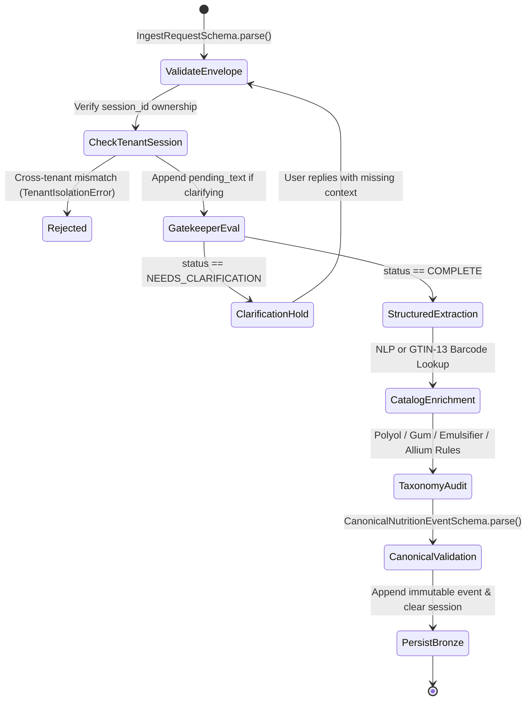

# Technical Architecture Specification

**DBMarketer | AI Nutrition & Ingredient Intelligence**  
*Multimodal AI, Governed Data Pipelines & Applied Analytics*  
Website: https://dbmarketer.com

---

## 1. Architectural Design Principles

Consumer and personal logging applications fail analytically long before any machine learning model runs: free-text meal entries omit preparation methods, sauces, and allergen certifications, while operational JSON schemas frequently drift away from downstream SQL warehouse expectations.

This architecture addresses those failure modes through four engineering invariants:

1. **Upstream Ambiguity Interception (`Gatekeeper` Pattern):** Unstructured inputs are evaluated for analytical completeness *before* database persistence. Ambiguous meals enter an ephemeral clarification hold rather than writing incomplete records.
2. **Single Canonical Data Contract (`Zod` ↔ `Medallion SQL`):** Operational event ingestion (`CanonicalNutritionEventSchema`), Silver 0/1 binary flags (`SilverFlattenedRowSchema`), and Gold lagged features (`GoldFeatureRowSchema`) enforce strict schema parity.
3. **Tenant-Isolated & Leakage-Safe Windowing:** Every conversational session and warehouse window is partitioned by `tenant_id`, and rolling exposure windows (`24h`, `48h`) use strict prior bounds (`RANGE BETWEEN 86400 PRECEDING AND 1 PRECEDING`) so contemporaneous outcomes never leak into predictors.
4. **Honest Analytical Governance:** Feature attributions and risk ratios are evaluated on chronological splits (`75/25` without shuffling), paired with collinearity diagnostics and 95% confidence intervals, and explicitly framed as observational associations rather than causal claims.

---

## 2. Multi-Stage Conversational State Machine

### Stage Breakdown
* **Stage 1 - Gatekeeper (`MockGeminiOrchestrator.evaluateGatekeeper`):** Inspects incoming text, barcode, or image metadata (`temperature = 0.1` in production `@google/genai`). Evaluates three domain completeness checks on food logs:
  1. `missing_gluten_verification` for grain/pasta/baked items.
  2. `missing_dressing_or_sauce` for composite dishes (salads, tacos, bowls, stir-fries).
  3. `missing_prep_state_raw_vs_cooked` for vegetables/greens (which materially alters digestive tolerance).
* **Stage 2 - Structured Extractor (`extractStructuredDraft`):** Parses relative time references (e.g., `"at 1pm"` -> UTC ISO-8601 `13:00:00.000Z`) and populates category-specific metadata (`food_metadata`, `symptom_metadata`, `supplement_metadata`, `context_metadata`).
* **Stage 3 - Nutrition Catalog & Taxonomy Auditor (`auditIngredientList`):** Decomposes ingredient lists into typed tags (`HIGH_FODMAP_POLYOL`, `LOW_RISK_POLYOL`, `HYDROCOLLOID_GUM`, `EMULSIFIER_IRRITANT`, `DAIRY_DERIVED`, `GLUTEN_RISK`, `HIDDEN_ALLIUM_RISK`, `SEED_OIL`). Distinguishes fermentable sugar alcohols (`Lactitol` E966, `Maltitol` E965, `Sorbitol` E420) from better-tolerated `Erythritol`, and triggers excipient advisories on liquid/chewable supplements.

---

## 3. Warehouse Medallion Lineage & Dual-Engine Verification

In the private production architecture, operational documents sync from Firestore into Google BigQuery (`logs_raw_latest`) for dbt transformation. Early prototype iterations exhibited a common operational-to-warehouse contract drift where LLM extraction produced nested `ingredients[].tags` arrays while legacy SQL queried flat string properties.

In this showcase, both the **BigQuery dbt reference models** (`warehouse/dbt_reference/`) and the **executable local Medallion engines** (`src/warehouse/medallionTransforms.js` and `src/warehouse/sqliteMedallionRunner.js`) implement the hardened contract:

| Medallion Layer | Model / Table Name | Grain & Materialization | Key Engineering Guarantees |
| :--- | :--- | :--- | :--- |
| **Bronze** | `stg_nutrition_events` | 1 row per `event_id` (`VIEW`) | Filters deleted change-stream records; enforces `tenant_id IS NOT NULL`; preserves dual timestamps (`event_timestamp`, `ingested_at`) and raw JSON payload for replayability. |
| **Silver** | `int_events_flattened` | 1 row per `event_id` (`VIEW`) | Unnests `food_metadata.ingredients[].tags` into deterministic `0/1` integer flags (`has_high_fodmap_polyol`, `has_hydrocolloid_gum`, `has_emulsifier_irritant`, `has_unverified_gluten_risk`, `is_raw_plant_prep`) and binary outcome `is_elevated_discomfort` (`discomfort_score >= 7`). |
| **Gold** | `fct_ml_feature_store` | 1 row per `event_id` (`TABLE`, partitioned by `event_date_utc`, clustered by `tenant_id, category`) | Computes rolling `24h` (`86,400s`) and `48h` (`172,800s`) exposure sums partitioned strictly by `tenant_id` using `RANGE BETWEEN 86400 PRECEDING AND 1 PRECEDING`. |

Automated test `tests/medallionAndModeling.test.js` executes the exact SQL window definitions inside Node's built-in `node:sqlite` engine and asserts **100% row-by-row parity** across all 410 synthetic Gold rows against the isomorphic JavaScript transformer used by the browser UI.

---

## 4. Longitudinal Analytics, BQML & Statistical Safeguards

The analytical layer pairs two complementary patterns (defined for BigQuery ML in `warehouse/dbt_reference/models/bqml_models_sanitized.sql` and implemented locally in `src/analytics/illustrativeModeling.js`):

1. **Lagged Exposure Association Model (`BOOSTED_TREE_CLASSIFIER` / Boosted Decision Stumps):**
   * **Split Governance:** Uses `data_split_method = 'SEQ'` ordered by `event_timestamp` (75% training, 25% held-out chronological evaluation). Random cross-validation is intentionally avoided because autocorrelated 24h/48h lag windows leak across adjacent timestamps under random splits.
   * **Uncertainty & Collinearity:** Reports held-out permutation log-loss attribution alongside Haldane-Anscombe continuity-corrected observational risk ratios (`95% CI`) and flags feature pairs with `|r| >= 0.35` (such as polyols, gums, and emulsifiers co-occurring inside packaged protein bars).
2. **Daily Baseline & Anomaly Monitoring (`ARIMA_PLUS` / Rolling Prediction Band):**
   * Models `daily_max_discomfort` partitioned by `tenant_id` (`time_series_id_col = 'tenant_id'`) to distinguish ordinary day-to-day fluctuation from above-band discomfort spikes (`> 95%` rolling interval).

---

## 5. External Adapter Boundaries in Offline Demo Mode

| Integration | Private Production Implementation | Public Showcase Adapter (`src/adapters/mockExternalServices.js`) |
| :--- | :--- | :--- |
| **LLM Routing & Extraction** | Google Gemini (`@google/genai` with `responseSchema`) | `MockGeminiOrchestrator` (deterministic rule-based ambiguity & extraction engine) |
| **Food & Barcode Catalog** | FatSecret Platform REST API (OAuth 2.0 + NLP v1, Barcode v2, Image v2) | `MockNutritionCatalogAdapter` (offline synthetic nutrition & additive fixtures) |
| **Academic Literature Search** | Semantic Scholar Graph API (`/graph/v1/paper/search`) | `LiteratureSynthesisInterface` (**Interface documented only**; live calls throw `OfflineDemoBoundaryError` so mock citations are never fabricated) |
| **Persistence & Warehouse** | Firebase Auth, Firestore, Cloud Functions v2, BigQuery + dbt | In-memory tenant session/event store + `node:sqlite` SQL runner + BigQuery dbt SQL reference |
