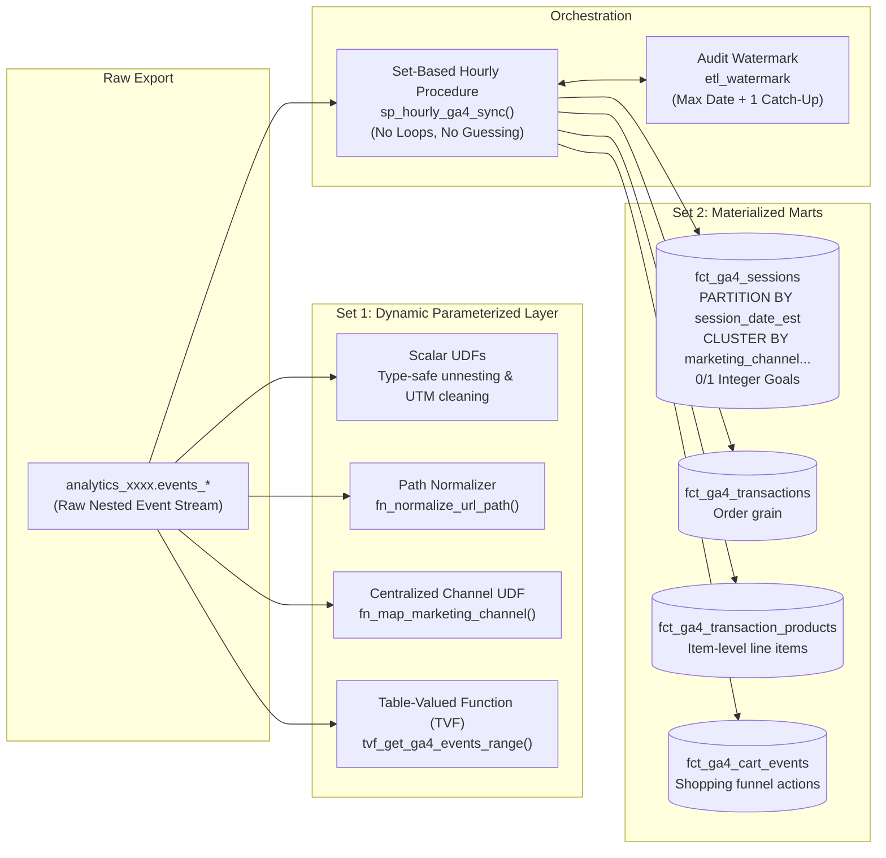
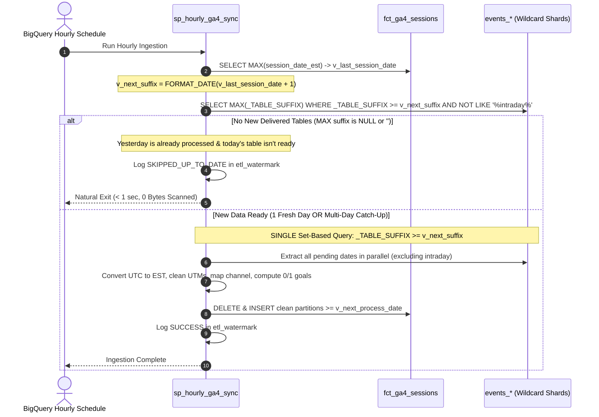

# The Production GA4 BigQuery Schema: How to Build High-Performance Session & Ecommerce Marts in Pure BigQuery SQL

**By [Rudy Martinez](https://dbmarketer.com)**  
*Principal Analytics Engineer & Founder, [Database Marketer (dbmarketer.com)](https://dbmarketer.com)*  
*Published: October 2026 • 25 min read*

---

> [!IMPORTANT]
> **Key Takeaway:** You do not need expensive 3rd-party ETL SaaS tools, complex Airflow DAGs, or slow procedural loops to turn raw Google Analytics 4 (GA4) BigQuery exports into analytics-ready dimensional marts. With a native **Dual-Set Architecture**, **0/1 integer goal flags**, **centralized marketing channel UDFs**, **date-partitioned storage**, and a **loop-free, set-based hourly procedure (`_TABLE_SUFFIX >= v_next_process_date`)**, you can build a resilient, blazing-fast data warehouse layer entirely inside BigQuery standard SQL with clean, snake_case column names (`session_id`, `session_date_est`, `session_start_est`, etc.).

---

## 1. The Anatomy of the GA4 BigQuery Problem

When engineering teams first connect the native GA4 BigQuery export, they expect a relational database of web analytics. Instead, Google hands them an event-level append-only log packed with deeply nested `RECORD` arrays:

```
project.analytics_<property_id>.events_YYYYMMDD
├── event_date: STRING ('20261027')
├── event_timestamp: INT64 (1761561600000000)
├── event_name: STRING ('page_view')
├── event_params: REPEATED RECORD
│   ├── key: STRING ('ga_session_id')
│   └── value: RECORD (string_value, int_value, float_value, double_value)
├── collected_traffic_source: RECORD
├── privacy_info: RECORD
└── items: REPEATED RECORD
```

For analysts and BI tools (Looker Studio, Power BI, Tableau), querying this structure directly creates six severe operational bottlenecks:

1. **Catastrophic Slot Consumption & Scanning Costs:** Every single parameter lookup (`page_location`, raw `ga_session_id`, `session_engaged`) requires an `UNNEST(event_params)` cross-join. A dashboard visual querying 90 days of web traffic scans the entire table multiple times, racking up massive BigQuery on-demand analysis fees and exhausting flat-rate slots.
2. **Attribution Fragmentation:** Marketers are notoriously inconsistent with link tagging. When campaign managers use `utm_source=Facebook`, `utm_source=facebook`, and `utm_source=FB`, standard reporting breaks. GA4's default channel grouping classifies mis-cased or missing parameters as `(Unassigned)`, masking return on ad spend (ROAS).
3. **Decentralized Channel Definitions:** Without a single source of truth, different teams write divergent `CASE WHEN` statements in their dashboards. One analyst classifies Facebook as `Paid Social`, while another puts it into `Social`, leading to executive confusion.
4. **The Trailing Slash Trap:** Web servers treat `/partners/acme` and `/partners/acme/` identically, but SQL string comparisons do not. Unnormalized URLs cause landing-page-based attribution to drop significant traffic volumes.
5. **The Timezone Midnight Trap:** The raw export provides `event_timestamp` as a microsecond integer in **UTC**, while the partition field `event_date` is a string formatted according to the **GA4 Admin Property Timezone**. When US East Coast sessions occur between 8:00 PM and 11:59 PM EST, their UTC timestamp belongs to the *next calendar day*. Inexperienced analysts running `DATE(TIMESTAMP_MICROS(event_timestamp))` end up reporting numbers that mismatch the GA4 UI and split multi-hour user journeys across dates.
6. **Consent Mode v2 Traffic Erasure:** Under Google Consent Mode v2, visitors rejecting analytics storage emit cookieless pings (`privacy_info.analytics_storage = 'NO'`). In these rows, `user_pseudo_id` is null or ephemeral, and raw `ga_session_id` is withheld. Queries filtering `WHERE user_pseudo_id IS NOT NULL` silently erase **20% to 40%** of European and privacy-conscious US traffic, distorting conversion baselines.

To resolve these challenges without adding external infrastructure, Database Marketer developed this **Production GA4 BigQuery Schema Architecture**.

---

## 2. The Dual-Set Architecture

Rather than forcing all analytical use cases through a single table, our architecture bifurcates consumption into two complementary sets:



### Set 1: The Dynamic Parameterized Query Layer (On-the-Fly Slice & Dice)
Built for data scientists, analytics engineers, and exploratory queries where materializing tables isn't necessary.
- **Persistent Scalar UDFs:** Standardize parsing for string, integer, and numeric event parameters, URL query decoding, and Eastern Time conversion.
- **Path Normalization UDF:** `fn_normalize_url_path` cleans landing page URLs by removing query parameters, hash fragments, and trailing slashes.
- **Centralized Marketing Channel UDF:** `fn_map_marketing_channel` encapsulates all channel rules into a single reusable definition.
- **Parameterized Table-Valued Function (TVF):** `ga4_utils.tvf_get_ga4_events_range(start_date, end_date)` allows users to query arbitrary date ranges with clean, flattened fields, lowercased UTMs, centralized marketing channels, and Eastern Time alignment without writing a single `UNNEST`.

### Set 2: The Materialized Production Marts (Hourly Incremental Warehouse)
Built for fast executive dashboards, BI reporting, and automated marketing feeds. Four partitioned and clustered physical tables updated every hour:
1. `fct_ga4_sessions`: Unified session grain with **daily date partitioning (`PARTITION BY session_date_est`)**, clustering by `marketing_channel, user_pseudo_id, session_id`, **0/1 integer goal flags**, lowercased UTMs, Eastern Time timestamps (`session_start_est`, `session_end_est`), normalized navigation pathing, and consent status.
2. `fct_ga4_transactions`: Deduplicated purchase orders with revenues, taxes, shipping, coupons, channel attribution, and session attribution.
3. `fct_ga4_transaction_products`: Unnested item-level line items with SKUs, categories (`item_category`, `item_category_2`, `item_category_3`), quantities, and item revenues.
4. `fct_ga4_cart_events`: Granular shopping event stream (`view_item`, `add_to_cart`, `remove_from_cart`, `view_cart`, `begin_checkout`).

---

## 3. Centralized Marketing Channel Mapping via UDF

A major source of technical debt in modern analytics teams is divergent channel definitions. When the Paid Media team builds a Looker dashboard, they often define `Paid Social` differently than the Finance team does in their dbt model.

Our framework introduces `ga4_utils.fn_map_marketing_channel` as the **single source of truth** across the entire data warehouse:

```sql
CREATE OR REPLACE FUNCTION `ga4_utils.fn_map_marketing_channel`(
  source STRING,
  medium STRING,
  campaign STRING,
  referrer STRING,
  landing_page_path STRING
)
RETURNS STRING
AS (
  CASE
    -- Rule 1: High-Priority Strategic Partnerships & Co-Marketing Portals
    WHEN landing_page_path LIKE '/partners%'
      OR landing_page_path LIKE '/co-marketing%'
      OR landing_page_path LIKE '/alliances%'
      OR LOWER(referrer) LIKE '%partnerportal.com%'
      OR LOWER(referrer) LIKE '%strategicpartner.org%'
      OR source IN ('strategic_partner', 'cobrand_partner', 'enterprise_affiliate')
      THEN 'Strategic Partnerships'

    -- Rule 2: Dedicated Influencer & Creator Landing Pages
    WHEN landing_page_path LIKE '/creators%'
      OR landing_page_path LIKE '/influencers%'
      OR medium IN ('influencer', 'creator', 'collab')
      THEN 'Influencer / Creator'

    -- Rule 3: Paid Search
    WHEN medium IN ('cpc', 'ppc', 'paidsearch', 'paid_search')
      OR (source IN ('google', 'bing', 'yahoo', 'duckduckgo', 'baidu') AND medium IN ('cpc', 'ppc'))
      THEN 'Paid Search'

    -- Rule 4: Paid Social
    WHEN medium IN ('paidsocial', 'paid_social', 'social_cpc', 'social_paid', 'social-cpc', 'paid-social')
      OR (source IN ('facebook', 'instagram', 'meta', 'tiktok', 'linkedin', 'pinterest', 'twitter', 'x', 'snapchat')
          AND (medium IN ('cpc', 'cpm', 'paid', 'ad', 'social_ad', 'paidad') OR campaign LIKE '%paid%'))
      THEN 'Paid Social'

    -- Rule 5: Organic Social
    WHEN medium IN ('social', 'social_network', 'social_media', 'sm', 'org_social', 'organic_social')
      OR source IN ('facebook', 'instagram', 'tiktok', 'linkedin', 'pinterest', 'twitter', 'x', 't.co', 'reddit', 'threads')
      OR LOWER(referrer) LIKE '%instagram.com%'
      OR LOWER(referrer) LIKE '%facebook.com%'
      OR LOWER(referrer) LIKE '%linkedin.com%'
      OR LOWER(referrer) LIKE '%tiktok.com%'
      OR LOWER(referrer) LIKE '%reddit.com%'
      THEN 'Organic Social'

    -- Rule 6: Email Marketing
    WHEN medium IN ('email', 'e-mail', 'newsletter', 'edm', 'flow', 'campaign_email')
      OR source IN ('klaviyo', 'mailchimp', 'braze', 'activecampaign', 'hubspot', 'sailthru', 'customerio')
      THEN 'Email'

    -- Rule 7: Affiliates
    WHEN medium IN ('affiliate', 'affiliates', 'aff')
      OR source IN ('rakuten', 'impact', 'shareasale', 'awin', 'cj', 'pepperjam')
      OR landing_page_path LIKE '/affiliate%'
      THEN 'Affiliates'

    -- Rule 8: Paid Video
    WHEN medium IN ('video', 'cpm_video')
      OR (source IN ('youtube', 'vimeo', 'hulu') AND medium IN ('cpc', 'cpm', 'paid'))
      THEN 'Paid Video'

    -- Rule 9: Organic Search
    WHEN medium = 'organic'
      OR source IN ('google', 'bing', 'yahoo', 'duckduckgo', 'ecosia', 'baidu')
      OR LOWER(referrer) LIKE '%google.%'
      OR LOWER(referrer) LIKE '%bing.%'
      OR LOWER(referrer) LIKE '%duckduckgo.%'
      THEN 'Organic Search'

    -- Rule 10: Referral (Generic non-partner web links)
    WHEN medium IN ('referral', 'referrals', 'link')
      OR (referrer IS NOT NULL AND referrer NOT IN ('', '(not set)') AND NOT (LOWER(referrer) LIKE '%google.%' OR LOWER(referrer) LIKE '%bing.%'))
      THEN 'Referral'

    -- Rule 11: Direct
    WHEN (source IS NULL OR source IN ('(direct)', 'direct'))
      AND (medium IS NULL OR medium IN ('(none)', '(not set)', 'none'))
      THEN 'Direct'

    -- Fallback
    ELSE 'Other'
  END
);
```

### Key Architectural Capabilities

#### 1. Defining Channels Based on Landing Page Alone
In many organizations, high-impact traffic arrives without UTM parameters because links are shared organically or distributed through co-marketing agreements. By passing `landing_page_path` into the UDF, a session landing on `/partners/acme` or `/creators/summer` can be immediately mapped to `Strategic Partnerships` or `Influencer / Creator`—even if the UTMs are completely empty or `(direct)`.

#### 2. Elevating Strategic Partner Referrers Above Generic "Referral"
Standard GA4 dumps every external website link into `Referral`. But if your brand has a major co-marketing partnership with an enterprise vendor or portal (e.g. `partnerportal.com`), dumping that traffic into generic referrals hides its ROI. Our UDF inspects the referrer domain and elevates strategic alliances into their own channel before generic referral fallback rules apply.

#### 3. Trailing Slash Normalization via `fn_normalize_url_path`
Urls frequently arrive as `/partners/enterprise/` or `/partners/enterprise?utm_source=ad`. If an analyst writes `WHERE landing_page = '/partners/enterprise'`, visits with trailing slashes or query strings are dropped.
Our normalization function cleans this in a single call:
```sql
CREATE OR REPLACE FUNCTION `ga4_utils.fn_normalize_url_path`(url STRING)
RETURNS STRING
AS ((
  SELECT
    CASE
      WHEN cleaned_path IS NULL OR cleaned_path IN ('', '/') THEN '/'
      ELSE REGEXP_REPLACE(cleaned_path, r'/+$', '')
    END
  FROM (
    SELECT LOWER(TRIM(
      COALESCE(
        REGEXP_EXTRACT(url, r'^[a-zA-Z]+://[^/?#]+([^?#]*)'),
        REGEXP_EXTRACT(url, r'^([^?#]*)')
      )
    )) AS cleaned_path
  )
));
```

---

## 4. The Maintenance Trade-Off: Pre-Materialization vs. Query-Time Execution

A central architectural decision in analytics engineering is deciding **where** the channel mapping logic should execute.

### Approach A: Pre-Materialized Column in `fct_ga4_sessions` (Our Implementation)
In our architecture, `sp_hourly_ga4_sync` executes the UDF at ingest time and permanently writes `marketing_channel` to `fct_ga4_sessions`.
- **The Advantages:**
  - **Zero Query-Time CPU Overhead:** Dashboards load instantly because BigQuery reads a simple pre-computed string.
  - **Partition & Cluster Pruning:** Because the table is clustered on `CLUSTER BY marketing_channel, ...`, a query filtering `WHERE marketing_channel = 'Paid Search'` scans only the specific storage blocks containing Paid Search rows, saving 80%+ on query scan costs.
- **The Operational Trade-off (What Happens When Rules Change?):**
  - If marketing reclassifies an affiliate network or creates a new channel rule, updating the UDF **does not automatically change historical rows** in `fct_ga4_sessions`.
  - **The Remediation:** You must run a targeted partition update to refresh historical sessions:
    ```sql
    UPDATE `ga4_marts.fct_ga4_sessions`
    SET marketing_channel = `ga4_utils.fn_map_marketing_channel`(
      utm_source,
      utm_medium,
      utm_campaign,
      page_referrer,
      landing_page_path
    )
    WHERE session_date_est BETWEEN '2026-09-01' AND '2026-10-27';
    ```

### Approach B: Query-Time Dynamic UDF Execution
Alternatively, you can omit the physical column and invoke `fn_map_marketing_channel(...)` dynamically inside a SQL query or a dynamic BigQuery VIEW.
- **The Advantages:**
  - **Instant Rule Propagation:** Any edit to the UDF is immediately reflected across all queries with zero backfilling or DML updates.
- **The Disadvantages:**
  - **Significant Compute Costs (Slot Exhaustion):** BigQuery must execute complex string matching and regex logic for every single session row on every single dashboard refresh.
  - **Loss of Cluster Pruning:** You cannot cluster on a dynamically computed function call.

---

## 5. The Hourly Ingestion Engine: No Loops, No Guessing Games, Pure Set-Based BigQuery

Many data teams fall into one of two orchestration anti-patterns:
1. **The Rolling Lookback Anti-Pattern:** Guessing with a blunt `INTERVAL 3 DAY` MERGE every hour, creating resource contention and wasting slot-hours when zero new data has landed.
2. **The Procedural Loop Anti-Pattern:** Writing cursor or procedural `FOR` loops to process days one by one, forfeiting BigQuery's massive MPP parallel processing power.

### The dbmarketer Philosophy: Set-Based Wildcard Extraction
Google's daily export model has two fundamental rules:
1. **`10/25/2026` sessions do not arrive over multiple days.** When Google finishes and delivers `events_20261025`, that daily export table is closed and settled.
2. **BigQuery is a set-based engine.** If you need to catch up across 3 missing days, you don't iterate through them one at a time. You query the wildcard table with `_TABLE_SUFFIX >= v_next_process_date` and process all 3 days in parallel in a single query!



### The Three Operational Scenarios Handled Flawlessly:

#### Scenario 1: Normal Hourly Run (Natural Idle Exit)
- It's 2:00 PM on October 27th.
- `fct_ga4_sessions` has data up to **October 26th** (yesterday).
- The procedure checks for `_TABLE_SUFFIX >= '20261027'` (today).
- Because today is still in progress, Google has not finalized `events_20261027`.
- The metadata check returns `NULL`.
- **The procedure logs `SKIPPED_UP_TO_DATE` and terminates in under 1 second.** Zero bytes scanned, zero query slots consumed.

#### Scenario 2: Google Delivers Yesterday's Table
- It's 6:00 AM on October 27th. Google finishes processing and delivers `events_20261026`.
- The procedure checks: Last processed date was `2026-10-25`. Next suffix is `'20261026'`.
- The metadata check returns `MAX(_TABLE_SUFFIX) = '20261026'`.
- The single set-based query extracts and materializes all sessions for `2026-10-26` in seconds.
- At 7:00 AM, 8:00 AM, and 9:00 AM, the procedure runs, sees `_TABLE_SUFFIX >= '20261027'` is not yet ready, and naturally exits.

#### Scenario 3: Catch-Up Mode (Google 48h Delay or 3-Day Job Outage)
- Suppose the job was paused over a 3-day long weekend, or Google experienced an upstream pipeline delay and delivers 3 days of backlog at once (`20261024`, `20261025`, `20261026`).
- Last processed date is `2026-10-23`. Next suffix is `'20261024'`.
- The metadata check returns `MAX(_TABLE_SUFFIX) = '20261026'`.
- **No loop is executed.** The procedure runs a single set-based query:
  ```sql
  WHERE _TABLE_SUFFIX >= '20261024'
    AND NOT REGEXP_CONTAINS(_TABLE_SUFFIX, r'intraday')
  ```
- BigQuery processes all 3 days concurrently across hundreds of parallel workers, writes the three date partitions into `fct_ga4_sessions`, and updates the watermark in one atomic run.

### Deploying the Routines & Setting Up the Hourly Scheduled Call

In BigQuery terminology, User-Defined Functions (both scalar and table-valued) and Stored Procedures are formally catalogued as **Routines**.

#### 1. The Routine Source Scripts
All routines are provided in two ready-to-run formats in the `sql/` directory:
- **Consolidated All-In-One Script ([`sql/01_create_all_routines.sql`](sql/01_create_all_routines.sql)):** Deploys all 11 BigQuery routines in one single execution (all 9 scalar UDFs, the 1 TVF, and the `sp_hourly_ga4_sync` stored procedure).
- **Modular Scripts:**
  - [`sql/01_udfs.sql`](sql/01_udfs.sql): Deploys the 9 parsing and channel-mapping scalar UDFs and the `tvf_get_ga4_events_range` table-valued function.
  - [`sql/03_procedure_hourly_sync.sql`](sql/03_procedure_hourly_sync.sql): Deploys the `sp_hourly_ga4_sync` stored procedure.
- **Scheduling Guide ([`sql/05_schedule_hourly_sync.sql`](sql/05_schedule_hourly_sync.sql)):** Contains the SQL trigger, console instructions, bq CLI command, and Terraform definition.

#### 2. Setting Up the Hourly Scheduled Call via BigQuery Console UI
Once the routines are created, set up the hourly scheduled execution directly in Google Cloud Console:
1. Open **BigQuery Studio** (`https://console.cloud.google.com/bigquery`).
2. Paste the routine execution statement into the Query Editor:
   ```sql
   CALL `your_project_id.ga4_marts.sp_hourly_ga4_sync`(NULL);
   ```
3. Click the **Schedule** dropdown in the query toolbar and choose **Create new scheduled query**.
4. Configure the scheduled query settings:
   - **Name for scheduled query:** `ga4_marts_hourly_sync`
   - **Repeats:** `Hourly`
   - **Starts:** Default (Immediately)
   - **Dataset:** Leave blank (the stored procedure handles all table destination writes)
   - **Destination table:** Leave blank
   - **Location:** Select your dataset region (e.g. `US` or `EU`)
5. Click **Save**. BigQuery will now trigger the routine at minute 0 of every hour.

#### 3. Setting Up the Hourly Scheduled Call via Google Cloud CLI (`bq mk`)
Alternatively, deploy the scheduled query with a single terminal command:
```bash
bq mk \
  --transfer_config \
  --project_id="YOUR_PROJECT_ID" \
  --data_source=scheduled_query \
  --display_name="GA4 Marts Hourly Sync" \
  --schedule="every 1 hours" \
  --location="US" \
  --params='{"query":"CALL `YOUR_PROJECT_ID.ga4_marts.sp_hourly_ga4_sync`(NULL);"}'
```

#### 4. Monitoring the Hourly Routine
Every hourly run records its progress, processed row counts, and status in `ga4_marts.etl_watermark`:
```sql
SELECT
  execution_timestamp,
  table_name,
  last_processed_date_est,
  rows_processed,
  execution_status,
  notes
FROM `ga4_marts.etl_watermark`
ORDER BY execution_timestamp DESC
LIMIT 20;
```

---

## 6. Date Partitioning & Multi-Column Clustering Strategy

Google BigQuery pricing is based entirely on the number of bytes scanned (or slot-hours consumed). Storing millions of sessions in a non-partitioned table is a guaranteed recipe for massive cloud bills.

### Daily Date Partitioning: `PARTITION BY session_date_est`
`fct_ga4_sessions` is partitioned by the Eastern Time business date (`session_date_est`).
```sql
CREATE TABLE IF NOT EXISTS `ga4_marts.fct_ga4_sessions` (
  ...
)
PARTITION BY session_date_est
CLUSTER BY marketing_channel, user_pseudo_id, session_id
```

When an analyst queries:
```sql
WHERE session_date_est >= DATE_SUB(CURRENT_DATE('America/New_York'), INTERVAL 30 DAY)
```
BigQuery automatically prunes all partitions outside that 30-day window. Years of historical web traffic are completely ignored, reducing query bytes scanned by **90% to 98%**.

### Multi-Column Clustering: `marketing_channel`, `user_pseudo_id`, `session_id`
Within each date partition, BigQuery collocates data blocks based on clustering keys:
1. **`marketing_channel`:** Placed first in the clustering list because almost every marketing report filters by channel (`WHERE marketing_channel = 'Paid Social'`).
2. **`user_pseudo_id`:** Enables rapid user-level stitching and cohort retention lookups.
3. **`session_id`:** Speeds up session deduplication and cross-table joins with orders.

---

## 7. The 0/1 Integer Goal Flag Revolution

In web analytics, businesses live and die by conversion funnels. In our target architecture, we assume five core ecommerce and lead generation goals:
1. `view_item` (Product Detail Page View)
2. `add_to_cart` (Cart Addition)
3. `checkout` (Initiated Checkout)
4. `purchase` (Completed Order)
5. `newsletter_signup` (Lead or Email Capture)

### Why Binary `INT64` (0 or 1) Flags are Superior
In `fct_ga4_sessions`, each goal is evaluated as a strict `INT64` with values of only `0` or `1`:

```sql
MAX(IF(event_name = 'view_item', 1, 0)) AS has_view_item,
MAX(IF(event_name = 'add_to_cart', 1, 0)) AS has_add_to_cart,
MAX(IF(event_name IN ('begin_checkout', 'checkout'), 1, 0)) AS has_checkout,
MAX(IF(event_name = 'purchase', 1, 0)) AS has_purchase,
MAX(IF(event_name IN ('newsletter_signup', 'email_signup', 'lead', 'sign_up'), 1, 0)) AS has_newsletter_signup
```

This simple architectural shift unlocks mathematical superpowers:

1. **Volume via `SUM()`:** The count of sessions reaching a goal is simply `SUM(has_goal)`. Because addition is commutative and associative, BigQuery aggregates these fields using high-speed SIMD vector processing.
2. **Conversion Rate via `AVG()`:** The conversion rate of any goal across any slice of data is simply `AVG(has_goal)`. For example, `AVG(has_purchase)` returns `0.0342` (a 3.42% conversion rate).
3. **Trivial BI Setup:** In Looker Studio or Power BI, drag `has_purchase` into your scorecard or table:
   - Aggregation = `SUM` -> Instant Total Conversions.
   - Aggregation = `AVERAGE` -> Instant Conversion Rate %.
4. **Additive Multi-Goal Funnels in a Single Pass:**

```sql
-- Clean, Fast, Additive Channel Funnel
SELECT
  marketing_channel,
  COUNT(1) AS total_sessions,
  
  -- Volumes
  SUM(has_view_item) AS views,
  SUM(has_add_to_cart) AS cart_adds,
  SUM(has_checkout) AS checkouts,
  SUM(has_purchase) AS purchases,
  SUM(has_newsletter_signup) AS leads,

  -- Micro-Conversion Rates
  ROUND(AVG(has_view_item) * 100, 2) AS view_rate_pct,
  ROUND(AVG(has_add_to_cart) * 100, 2) AS cart_rate_pct,
  ROUND(AVG(has_checkout) * 100, 2) AS checkout_rate_pct,
  ROUND(AVG(has_purchase) * 100, 2) AS purchase_cvr_pct,
  ROUND(AVG(has_newsletter_signup) * 100, 2) AS lead_cvr_pct
FROM `ga4_marts.fct_ga4_sessions`
WHERE session_date_est >= DATE_SUB(CURRENT_DATE('America/New_York'), INTERVAL 30 DAY)
GROUP BY marketing_channel
ORDER BY purchases DESC;
```

---

## 8. The Timezone Trap: UTC Event Timestamp vs. Admin Property Timezone

One of the most insidious bugs in GA4 BigQuery pipelines is the mismatch between event timestamps and reporting dates.

### The Underlying Mechanics
1. **`event_timestamp`:** Stored as an integer representing microseconds elapsed since the Unix epoch (January 1, 1970). **This timestamp is ALWAYS in UTC.**
2. **`event_date`:** Stored as a string (e.g. `'20261027'`). **This date is determined by the Reporting Timezone configured in your GA4 Property Admin settings** (for example, `America/New_York` or `America/Los_Angeles`).

### The Midnight Boundary Bug
Imagine a customer in New York purchases an item at **9:30 PM EST on October 27, 2026**:
- **Local Time (New York):** `2026-10-27 21:30:00 EST`
- **UTC Equivalent:** `2026-10-28 01:30:00 UTC`
- **GA4 `event_date` in table:** `'20261027'` (Because GA4 admin is set to New York)
- **GA4 `event_timestamp` in table:** `1793151000000000` (UTC microseconds)

If an analyst writes:
```sql
-- WRONG: Defaults to UTC calendar date
SELECT 
  DATE(TIMESTAMP_MICROS(event_timestamp)) AS session_date,
  COUNT(1) 
FROM raw_events 
GROUP BY 1;
```
BigQuery casts the timestamp to UTC date: **October 28th**.  
Meanwhile, the GA4 UI reports the transaction on **October 27th**. The CEO compares the dashboard against the GA4 UI, sees mismatched daily revenues, and assumes the data warehouse is broken.

### The Solution: Explicit Microsecond-to-Eastern Conversion
Our pipeline introduces dedicated functions that explicitly convert UTC timestamps to `America/New_York` (handling both Standard Time and Daylight Saving Time automatically):

```sql
CREATE OR REPLACE FUNCTION `ga4_utils.fn_utc_to_est_datetime`(ts_micros INT64)
RETURNS DATETIME
AS (
  DATETIME(TIMESTAMP_MICROS(ts_micros), 'America/New_York')
);

CREATE OR REPLACE FUNCTION `ga4_utils.fn_utc_to_est_date`(ts_micros INT64)
RETURNS DATE
AS (
  DATE(TIMESTAMP_MICROS(ts_micros), 'America/New_York')
);
```

In `fct_ga4_sessions`, we partition on `session_date_est`, ensuring that session durations (`DATETIME_DIFF(session_end_est, session_start_est, SECOND)`), daily rollups, and hour-of-day charts align 100% with real-world US commercial hours.

---

## 9. Consent Mode v2: Retaining Unconsented Users

Under Google Consent Mode v2, visitors who reject tracking cookies emit cookieless pings (`privacy_info.analytics_storage = 'NO'`). In these pings:
1. GA4 does not read or write the `_ga` cookie.
2. `user_pseudo_id` is either `NULL` or replaced with an ephemeral string.
3. The parameter `ga_session_id` is completely omitted from raw `event_params`.

### Why Naive Pipelines Drop 20% to 40% of Users
Most engineers write their session extraction as:
```sql
-- WRONG: Silently deletes unconsented traffic!
SELECT
  user_pseudo_id,
  (SELECT value.int_value FROM UNNEST(event_params) WHERE key = 'ga_session_id') AS session_id
FROM raw_events
WHERE user_pseudo_id IS NOT NULL;
```
By doing this, **every unconsented user is dropped from your reporting warehouse**. Your site traffic drops, your customer acquisition cost (CAC) calculations are skewed, and your bounce rates become inaccurate.

### The dbmarketer Fallback Strategy
Our architecture refuses to discard unconsented visitors. We handle them by:
1. Creating a deterministic synthetic session key using BigQuery's `FARM_FINGERPRINT` across the anonymous payload:
   ```sql
   COALESCE(
     IF(user_pseudo_id IS NOT NULL AND session_id IS NOT NULL,
        CONCAT(user_pseudo_id, '.', CAST(session_id AS STRING)),
        NULL),
     CONCAT('anon.', event_date, '.', CAST(FARM_FINGERPRINT(CONCAT(COALESCE(user_pseudo_id, 'unconsented'), CAST(event_timestamp AS STRING), COALESCE(geo.country, ''))) AS STRING))
   ) AS session_key
   ```
2. Storing explicit consent columns on each session:
   - `consent_status`: `'GRANTED'`, `'DENIED'`, or `'UNKNOWN'`.
   - `is_consented`: `1` (Granted) or `0` (Denied/Cookieless).

This preserves true site traffic baselines while enabling powerful privacy analytics, such as comparing the conversion propensity of consented vs. unconsented visitors.

---

## 10. The UTM Normalization Framework: Lowercasing & The 9-Parameter Matrix

Attribution errors in web analytics are rarely caused by math; they are caused by string casing and redirect stripping.

### The Case Sensitivity Trap
In SQL, string comparisons are case-sensitive:
```sql
'Facebook' != 'facebook' != 'FACEBOOK'
```
When campaign managers run paid ads across different teams, variations in UTM capitalization create split rows in grouping tables. Even worse, GA4's channel grouping rules fail to match title-cased parameters, tossing paid media traffic into `(Unassigned)`.

Our pipeline enforces rigorous normalization via `ga4_utils.fn_clean_utm`:
```sql
CREATE OR REPLACE FUNCTION `ga4_utils.fn_clean_utm`(raw_val STRING)
RETURNS STRING
AS (
  NULLIF(LOWER(TRIM(REGEXP_REPLACE(raw_val, r'\+', ' '))), '')
);
```
- Forces all characters to lowercase.
- Trims leading and trailing whitespace.
- Replaces URL-encoded `+` symbols with standard spaces.
- Converts empty strings `''` into true SQL `NULL`s.

### Full Spectrum Coverage: All 9 UTM Parameters
Our schema models the full 9-parameter matrix, including Google's modern paid media taxonomy:

| Parameter | Type | Business Definition | Typical Production Value |
| :--- | :--- | :--- | :--- |
| `utm_source` | STRING | The entity sending the traffic | `google`, `facebook`, `klaviyo`, `tiktok` |
| `utm_medium` | STRING | The marketing mechanism | `cpc`, `paid_social`, `email`, `affiliate` |
| `utm_campaign` | STRING | The strategic campaign name | `spring_sale_2026`, `brand_search_exact` |
| `utm_term` | STRING | Search query keyword or targeting audience | `running shoes`, `lookalike_3pct` |
| `utm_content` | STRING | Specific ad creative, copy variant, or link | `hero_banner_blue`, `copy_v2_cta_shop` |
| `utm_id` | STRING | External platform Campaign / Ad ID | `cid_192847193` |
| `utm_source_platform` | STRING | Specific buying tool or ad engine | `google ads`, `dv360`, `sa360`, `meta ads` |
| `utm_creative_format` | STRING | Visual layout / ad format | `carousel`, `single_image`, `video_reel` |
| `utm_marketing_tactic` | STRING | Funnel stage or campaign objective | `prospecting`, `retargeting`, `retention` |

---

## 11. Production Schema Data Dictionary

### Table: `ga4_marts.fct_ga4_sessions`
- **Partitioning:** `session_date_est` (Daily Eastern Time)
- **Clustering:** `marketing_channel`, `user_pseudo_id`, `session_id`

| Column | Type | Description |
| :--- | :--- | :--- |
| `session_key` | STRING | Primary key (`user_pseudo_id.session_id` or synthetic hash) |
| `session_date_est` | DATE | **Partition Key:** Session start date in Eastern Time (`America/New_York`) |
| `session_start_est` | DATETIME | First event timestamp in Eastern Time |
| `session_end_est` | DATETIME | Last event timestamp in Eastern Time |
| `session_duration_seconds` | INT64 | Total active session duration |
| `user_pseudo_id` | STRING | GA4 client cookie identifier (NULL for unconsented users) |
| `session_id` | INT64 | Session counter timestamp from gtag.js (`ga_session_id`) |
| `session_number` | INT64 | Ordinal session count for the user (`ga_session_number`) |
| `consent_status` | STRING | `'GRANTED'`, `'DENIED'`, or `'UNKNOWN'` |
| `is_consented` | INT64 | Binary flag: `1` if consented, `0` otherwise |
| `landing_page` | STRING | Full raw entry page URL |
| `landing_page_path` | STRING | Normalized entry page path (query params & trailing slash stripped) |
| `landing_page_title` | STRING | Page title of the entry page |
| `exit_page` | STRING | Exit page URL |
| `page_referrer` | STRING | HTTP referrer recorded at session start |
| `page_views` | INT64 | Count of `page_view` events in session |
| `event_count` | INT64 | Total events in session |
| **`marketing_channel`** | **STRING** | **Centralized channel mapped via `fn_map_marketing_channel` (Cluster Key 1)** |
| `utm_source` | STRING | Cleaned lowercased traffic source |
| `utm_medium` | STRING | Cleaned lowercased medium |
| `utm_campaign` | STRING | Cleaned lowercased campaign |
| `utm_term` | STRING | Cleaned lowercased keyword/term |
| `utm_content` | STRING | Cleaned lowercased ad content |
| `utm_id` | STRING | Cleaned lowercased campaign ID |
| `utm_source_platform` | STRING | Cleaned lowercased source platform |
| `utm_creative_format` | STRING | Cleaned lowercased creative format |
| `utm_marketing_tactic` | STRING | Cleaned lowercased marketing tactic |
| `device_category` | STRING | `desktop`, `mobile`, or `tablet` |
| `device_os` | STRING | Operating system |
| `device_browser` | STRING | Browser name |
| `geo_country` | STRING | Visitor country |
| `geo_region` | STRING | Visitor region / state |
| `geo_city` | STRING | Visitor city |
| **`has_view_item`** | **INT64** | **1 if viewed product page, 0 otherwise** |
| **`has_add_to_cart`** | **INT64** | **1 if added to cart, 0 otherwise** |
| **`has_checkout`** | **INT64** | **1 if began checkout, 0 otherwise** |
| **`has_purchase`** | **INT64** | **1 if completed purchase, 0 otherwise** |
| **`has_newsletter_signup`** | **INT64** | **1 if triggered newsletter/lead signup, 0 otherwise** |
| `total_purchase_revenue` | NUMERIC | Total order revenue generated in session |
| `total_items_purchased` | INT64 | Total units purchased in session |
| `transactions_count` | INT64 | Count of transactions in session |
| `processed_at` | TIMESTAMP | Timestamp when row was transformed |

---

## 12. Conclusion & Next Steps

Transforming raw Google Analytics 4 data into an executive-grade warehouse doesn't require complex third-party tools or convoluted SQL models. By taking advantage of **pure BigQuery standard SQL**, **centralized channel mapping UDFs**, **0/1 integer flags**, **date-partitioned storage**, and a **set-based wildcard procedure**, data teams can build a high-performance analytics platform that scales effortlessly.

### Need Help Optimizing Your Marketing Data Stack?
At **[Database Marketer (dbmarketer.com)](https://dbmarketer.com)**, we design and build enterprise-grade data platforms, dbt models, and custom AI agent skills for high-growth ecommerce and subscription brands.

- **Explore our services:** [dbmarketer.com](https://dbmarketer.com)
- **Schedule an Architecture Review:** [dbmarketer.com/#contact](https://dbmarketer.com/#contact)
- **Open-Source Repository:** [github.com/dbmarketer/ga4-bigquery-schema](https://github.com/rudy0903/dbmarketer/tree/main/ga4-bigquery-schema)

---

## 13. DIY Implementation Guide: Git Repository & Script Inventory

For data teams ready to deploy this architecture into their own Google Cloud environment, all assets are packaged into a modular, production-tested Git repository. This section provides an architectural overview of what is contained in the Git repository and a functional summary of what each script does—allowing you to execute **Option #1 (Turnkey Automated Deployment)** quickly and reliably without needing to manually copy and paste code blocks.

### What is in the Git Repository

The repository is structured into four core directories:

1. **`scripts/` (Automated Orchestration):** Turnkey deployment scripts designed for CI/CD runners, Google Cloud Shell, and local developer workstations (macOS, Linux, and Windows PowerShell).
2. **`sql/` (Database Assets & Routines):** Pure BigQuery SQL files containing dataset initialization, 11 compiled routines (9 scalar UDFs, 1 table-valued function, and 1 stored procedure), partitioned table DDLs, analytical business queries, and scheduling templates.
3. **`schemas/` (BigQuery JSON Schemas):** Production-ready JSON schema definitions matching BigQuery's native table definition format for automated schema validation, migration tools, or deployment via `bq mk --schema`.
4. **Root Documentation & Licensing:** The comprehensive architectural whitepaper (`ARTICLE.md`), an interactive executive HTML document (`ARTICLE.html`), the repository guide (`README.md`), and an Apache 2.0 open-source license (`LICENSE`).

---

### Script Inventory & Functional Summary

The table below summarizes each file in the repository, its target BigQuery object or operational scope, and what it executes:

| Directory | Script / Asset | Target Object / Scope | Functional Summary |
| :--- | :--- | :--- | :--- |
| `scripts/` | `deploy_all.sh` | Bash / Linux / Cloud Shell | **Option #1 Turnkey Deployer (Mac/Linux):** Validates GCP credentials, resolves the active project ID, executes all SQL steps sequentially (datasets $\rightarrow$ routines $\rightarrow$ tables), and schedules the hourly routine call via `bq mk`. |
| `scripts/` | `deploy_all.ps1` | Windows PowerShell | **Option #1 Turnkey Deployer (Windows):** Native PowerShell equivalent of `deploy_all.sh`. Automates parameter passing, execution order, error trapping, and scheduled query creation. |
| `sql/` | `00_init_datasets.sql` | `ga4_marts`, `ga4_utils`, `ga4_staging` | Initializes the isolated BigQuery datasets with descriptions and location flags, establishing clean boundaries between raw staging, utilities, and analytical marts. |
| `sql/` | `01_create_all_routines.sql` | 11 BigQuery Routines | **All-in-One Routine Installer:** Compiles and registers all 9 scalar UDFs, the 1 table-valued function (`tvf_get_ga4_events_range`), and the `sp_hourly_ga4_sync` stored procedure in a single execution. |
| `sql/` | `01_udfs.sql` | Scalar UDFs & TVF | **Modular Routine Script:** Instantiates the 9 parameter-parsing, URL-normalizing, timezone-converting, and channel-mapping functions, plus the dynamic ad-hoc querying TVF. |
| `sql/` | `02_ddl_tables.sql` | 5 Mart Tables | Provisions the physical storage layer: `etl_watermark`, `fct_ga4_sessions`, `fct_ga4_transactions`, `fct_ga4_transaction_products`, and `fct_ga4_cart_events`. Enforces daily Eastern Time date partitioning (`PARTITION BY session_date_est`) and multi-column clustering. |
| `sql/` | `03_procedure_hourly_sync.sql` | `ga4_marts.sp_hourly_ga4_sync` | **Modular Ingestion Engine:** Creates the set-based stored procedure that checks for new settled data, handles multi-day backlogs concurrently via `_TABLE_SUFFIX`, enforces idempotent partition rewrites, and records execution logs. |
| `sql/` | `04_analytical_queries.sql` | Analytical Query Library | Contains 6 production-grade SQL templates demonstrating 0/1 integer goal aggregation, channel performance reporting, strategic partner referrer audits, retroactive rule updates, and cost-comparison benchmarks. |
| `sql/` | `05_schedule_hourly_sync.sql` | Scheduling & Monitoring | Provides the single-line routine caller (`CALL ga4_marts.sp_hourly_ga4_sync(NULL);`), step-by-step BigQuery Studio UI configuration instructions, the `bq mk --transfer_config` CLI command, and Terraform IaC definitions. |
| `schemas/` | `*.schema.json` | Table Definitions | 4 BigQuery JSON schema definitions detailing field names, types, nullability modes, and inline column documentation for automated CI/CD validation. |

---

### Executing Option #1: Turnkey Deployment

To deploy the entire architecture into your Google Cloud project in under 5 minutes:

1. **Clone the repository:**
   ```bash
   git clone https://github.com/rudy0903/dbmarketer.git
   cd dbmarketer/ga4-bigquery-schema
   ```

2. **Execute the automated deployment script:**
   - **Linux / macOS / Google Cloud Shell:**
     ```bash
     chmod +x scripts/deploy_all.sh
     ./scripts/deploy_all.sh "your-gcp-project-id" "US"
     ```
   - **Windows (PowerShell):**
     ```powershell
     .\scripts\deploy_all.ps1 -ProjectId "your-gcp-project-id" -Location "US"
     ```

3. **Verify Execution Health:**
   Once triggered, inspect the `etl_watermark` table to confirm the ingestion pipeline is operational:
   ```sql
   SELECT * 
   FROM `ga4_marts.etl_watermark` 
   ORDER BY execution_timestamp DESC 
   LIMIT 10;
   ```
