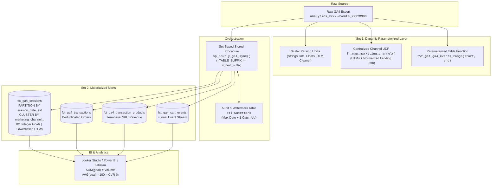
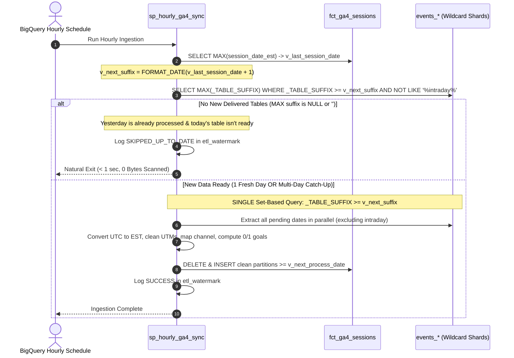

<div align="center">

# ⚡ GA4 BigQuery Production Schema & Analytics Marts
### *The Battle-Tested, Pure-BigQuery SQL Architecture for High-Volume Ecommerce & Lead Gen*

[](https://dbmarketer.com)
[](https://cloud.google.com/bigquery)
[](LICENSE)

**A production-tested, pure-BigQuery SQL data modeling framework that converts raw events_* tables into date-partitioned session and ecommerce marts (ct_ga4_sessions, ct_ga4_transactions). Features 9 scalar UDFs, automated hourly set-based syncs, 0/1 integer goal flags, and full Google Consent Mode v2 retention with zero external orchestrator dependencies.**

[Architecture Deep Dive](ARTICLE.md) • [SQL Source Code](sql/) • [JSON Schemas](schemas/) • [Analytical Queries](sql/04_analytical_queries.sql)

---

</div>

## 📌 Why Does Querying Raw GA4 Data in BigQuery Cost So Much?

Querying the raw Google Analytics 4 (GA4) BigQuery export (`events_*`) directly in production is notoriously painful and expensive:
1. **Repeated Array Unnesting:** Massive record scanning costs and complex `UNNEST(event_params)` spaghetti SQL.
2. **The "Lookback Guessing Game":** Blindly re-running multi-day rolling `MERGE` queries 24 times a day wastes cloud budget and causes concurrency locks.
3. **Attribution Fragmentation:** Inconsistent UTM casing (`Facebook` vs `facebook`) splits traffic and throws ad dollars into `(Unassigned)`.
4. **Decentralized Channel Definitions:** Different departments and dashboards copy-paste disparate `CASE WHEN` logic, resulting in conflicting numbers across BI reports.
5. **The Trailing Slash Trap:** Inconsistent landing URLs (`/partners/acme/` vs `/partners/acme`) break fragile string-matching filters.
6. **The Timezone Midnight Split:** `event_timestamp` is **UTC microseconds**, while `event_date` is keyed to your **GA4 Admin Property Timezone**. Blindly casting UTC timestamps splits evening US sessions across calendar days.
7. **Consent Mode v2 Data Loss:** Naive queries filtering on `user_pseudo_id IS NOT NULL` discard up to **20%–40%** of traffic from unconsented EU/US visitors.
8. **Slow BI Metrics:** Calculating conversion rates in Looker Studio, Power BI, or Tableau requires heavy `COUNT(DISTINCT)` and conditional statements that bog down dashboard performance.

This repository provides a **100% BigQuery Native solution** (no dbt, no external Airflow, no third-party SaaS required). It introduces a dual-set operational model:



---

## 🚀 The Dual-Set Architecture

### Set 1: The Dynamic Parameterized Query Layer
- **Persistent Scalar UDFs:** Fast, type-safe unnesting (`fn_extract_param_string`, `fn_extract_param_int`, `fn_extract_param_float`, `fn_clean_utm`).
- **URL Path Normalization:** `fn_normalize_url_path(url)` strips query strings, fragments, and trailing slashes so `/partners/acme/` and `/partners/acme` match identically.
- **Centralized Marketing Channel UDF:** `fn_map_marketing_channel(source, medium, campaign, referrer, landing_page_path)` consolidates all channel rules into a single maintainable function.
- **Parameterized Table-Valued Function (TVF):** `tvf_get_ga4_events_range('20261001', '20261015')` lets analytics engineers slice, filter, and inspect raw event data across any date window without building permanent tables or paying for full partition scans.

### Set 2: Materialized Production Marts
Four partitioned and clustered physical tables populated by a set-based hourly stored procedure with clean, underscored column taxonomy:
1. `fct_ga4_sessions`: Session-grain table featuring **daily Eastern Time date partitioning (`PARTITION BY session_date_est`)**, clustering on `marketing_channel, user_pseudo_id, session_id`, **binary 0/1 integer goal flags**, full 9-parameter UTM coverage, and consent mode tracking.
2. `fct_ga4_transactions`: Deduplicated order-grain table with revenue, tax, shipping, coupon codes, and attribution.
3. `fct_ga4_transaction_products`: Line-item product grain table with SKUs, categories (`item_category`, `item_category_2`, `item_category_3`), prices, quantities, and item revenues.
4. `fct_ga4_cart_events`: Shopping action stream (`view_item`, `add_to_cart`, `remove_from_cart`, `view_cart`, `begin_checkout`) for micro-funnel analysis.

---

## ⏱️ How Does the Hourly Ingestion Engine Prevent Duplicate Sessions & High Costs?

The stored procedure [`ga4_marts.sp_hourly_ga4_sync`](sql/03_procedure_hourly_sync.sql) replaces arbitrary rolling lookbacks and slow procedural loops with a **clean, set-based wildcard query**:



### Key Behavioral Guarantees:
1. **Zero Guessing Games:** The pipeline inspects `MAX(session_date_est)` in `fct_ga4_sessions` and targets `v_next_suffix = FORMAT_DATE('%Y%m%d', MAX(session_date_est) + 1)`.
2. **Metadata-Driven Natural Exit:** If yesterday's data is already processed, `v_next_suffix` is today's date. Today's table is not yet delivered by Google (only lands tomorrow). The procedure scans 0 bytes, logs `SKIPPED_UP_TO_DATE`, and exits in < 1 second.
3. **No Loops (Parallel Catch-Up):** If 3 days of backlog arrive (due to an upstream delay or weekend pause), BigQuery does **not** loop day-by-day. It queries `WHERE _TABLE_SUFFIX >= v_next_suffix AND NOT REGEXP_CONTAINS(_TABLE_SUFFIX, r'intraday')` in a single query, processing all partitions in parallel.
4. **Closed Batch Guarantee:** In settled GA4 daily exports, **10/25 sessions do not arrive over multiple days**.

---

## 🎯 How Does the Centralized Channel Mapping UDF Work?

Marketing channel grouping rules often diverge across dashboards, dbt models, and ad-hoc analyst scripts. Our framework solves this by establishing **one canonical function**:

```sql
ga4_utils.fn_map_marketing_channel(
  utm_source, 
  utm_medium, 
  utm_campaign, 
  page_referrer, 
  landing_page_path
)
```

### Key Capabilities:
1. **Landing-Page-Driven Channels:** Defines channels based on landing page path alone (e.g. `/partners/*` or `/creators/*`), ensuring un-tagged partner or influencer visits are properly categorized.
2. **Elevated Partner Referrals:** Differentiates high-value strategic alliances from generic web referrals. If a referrer domain is `partnerportal.com` or the landing page is `/partners/enterprise`, it is classified as **"Strategic Partnerships"** rather than dumping it into "Referral".
3. **Trailing Slash Resilience:** `fn_normalize_url_path` cleans `/partners/xyz/` -> `/partners/xyz` before channel evaluation.

### ⚖️ The Architectural Trade-Off: Pre-Materialization vs. Query-Time Execution

| Approach | Where It Runs | Advantages | Disadvantages & Operational Nuance |
| :--- | :--- | :--- | :--- |
| **Pre-Materialized Column** *(Implemented in `fct_ga4_sessions`)* | Hourly Stored Procedure | **Zero query-time CPU cost.** Instant BI rendering. Enables partition and cluster pruning (`WHERE marketing_channel = 'Paid Social'`). | **Rule changes require retroactive updates:** If you change the channel mapping UDF, existing rows retain old labels. You must run an `UPDATE` on the date partition to backfill. |
| **Query-Time Dynamic UDF** | On-the-fly in `SELECT` or `VIEW` | **Instant rule updates:** Changing the UDF immediately updates all downstream views with zero backfilling. | **High compute cost:** BigQuery executes multi-branch regex on millions of rows on every dashboard load, increasing query latency and slot consumption. |

---

## 🎯 The Secret Weapon: 0/1 Integer Goal Flags

In `fct_ga4_sessions`, business goals are modeled as strict `INT64` binary flags:
- `has_view_item` (0 or 1)
- `has_add_to_cart` (0 or 1)
- `has_checkout` (0 or 1)
- `has_purchase` (0 or 1)
- `has_newsletter_signup` (0 or 1)

### Why 0/1 Integers Change Everything:
| Metric Need | Traditional Boolean / Raw Export | dbmarketer 0/1 Schema |
| :--- | :--- | :--- |
| **Total Conversions** | `COUNT(DISTINCT IF(event_name='purchase', session_id, NULL))` | `SUM(has_purchase)` |
| **Conversion Rate (CVR)** | `COUNT(DISTINCT purchase_session) / COUNT(DISTINCT session)` | `AVG(has_purchase) * 100` |
| **Multi-Goal Summary** | Multi-pass subqueries with joins | Single-pass `SUM()` and `AVG()` |
| **BI Tool Performance** | Sluggish computed fields; memory exhaustion | Instant column vector aggregation |

```sql
-- Single-pass Funnel Drop-off and Rates by Channel:
SELECT
  marketing_channel,
  COUNT(1) AS sessions,
  SUM(has_add_to_cart) AS cart_adds,
  SUM(has_purchase) AS purchases,
  ROUND(AVG(has_add_to_cart) * 100, 2) AS cart_add_rate_pct,
  ROUND(AVG(has_purchase) * 100, 2) AS session_cvr_pct,
  ROUND(SUM(total_purchase_revenue), 2) AS revenue
FROM `ga4_marts.fct_ga4_sessions`
WHERE session_date_est >= DATE_SUB(CURRENT_DATE('America/New_York'), INTERVAL 30 DAY)
GROUP BY marketing_channel
ORDER BY revenue DESC;
```

---

## 📅 How Are Date Partitioning & Multi-Column Clustering Configured?

`fct_ga4_sessions` enforces:
1. **`PARTITION BY session_date_est`**: Daily date partitions keyed to the Eastern Time business day. Querying `WHERE session_date_est >= '2026-10-01'` prunes all earlier partitions completely from memory.
2. **`CLUSTER BY marketing_channel, user_pseudo_id, session_id`**: Sorts and colocates rows by marketing channel, user, and session within each daily partition. Filtering on `WHERE marketing_channel = 'Strategic Partnerships'` reads only the exact storage blocks matching that channel.

---

## 🛡️ How Does the Schema Retain Unconsented Users Under Consent Mode v2?

Under Google Consent Mode v2, visitors rejecting analytics storage emit cookieless pings (`privacy_info.analytics_storage = 'NO'`). In these pings, `user_pseudo_id` and `session_id` are withheld or null. Discarding them deflates your true traffic count by 20% to 40%!

Our framework preserves unconsented visitors by generating a deterministic synthetic session key:
```sql
COALESCE(
  CONCAT(user_pseudo_id, '.', CAST(session_id AS STRING)),
  CONCAT('anon.', event_date, '.', CAST(FARM_FINGERPRINT(CONCAT(COALESCE(user_pseudo_id, 'unconsented'), CAST(event_timestamp AS STRING), COALESCE(geo.country, ''))) AS STRING))
) AS session_key
```

---

## 📂 Repository File Tree

```
ga4-bigquery-schema/
├── README.md                           # Open-source overview & documentation
├── ARTICLE.md                          # In-depth technical guide & whitepaper
├── ARTICLE.html                        # Executive standalone HTML document
├── LICENSE                             # Apache 2.0 License
├── scripts/                            # Turnkey deployment automation scripts
│   ├── deploy_all.sh                   # Bash deployment script (Mac / Linux / Cloud Shell)
│   └── deploy_all.ps1                  # PowerShell deployment script (Windows)
├── schemas/                            # BigQuery JSON Schema files
│   ├── fct_ga4_sessions.schema.json
│   ├── fct_ga4_transactions.schema.json
│   ├── fct_ga4_transaction_products.schema.json
│   └── fct_ga4_cart_events.schema.json
└── sql/                                # Production SQL DDL, UDFs, & Procedures
    ├── 00_init_datasets.sql            # Dataset creation (ga4_marts, ga4_utils, ga4_staging)
    ├── 01_create_all_routines.sql      # ALL-IN-ONE: Deploys all 11 BigQuery Routines (9 UDFs + 1 TVF + Procedure)
    ├── 01_udfs.sql                     # Modular: Scalar UDFs, Channel Mapping, & TVF (Set 1)
    ├── 02_ddl_tables.sql               # Date-Partitioned & Clustered Materialized Marts (Set 2)
    ├── 03_procedure_hourly_sync.sql    # Modular: Set-Based Wildcard Procedure (sp_hourly_ga4_sync)
    ├── 04_analytical_queries.sql       # High-performance business queries & partition updates
    └── 05_schedule_hourly_sync.sql     # Hourly scheduling guide, bq CLI one-liner & Terraform config
```

---

## 🛠️ Deployment & Routine Setup Guide

### Option 1: Turnkey Automated Deployment (1 Command)

If you have the Google Cloud CLI (`gcloud` / `bq`) installed:

**Linux / macOS / Cloud Shell:**
```bash
chmod +x scripts/deploy_all.sh
./scripts/deploy_all.sh "your-gcp-project-id" "US"
```

**Windows (PowerShell):**
```powershell
.\scripts\deploy_all.ps1 -ProjectId "your-gcp-project-id" -Location "US"
```

---

### Option 2: Step-by-Step BigQuery Console Setup

#### Step 1: Initialize Datasets
Open [BigQuery Studio](https://console.cloud.google.com/bigquery) and run [sql/00_init_datasets.sql](sql/00_init_datasets.sql) to create `ga4_marts`, `ga4_utils`, and `ga4_staging`.

#### Step 2: Create All BigQuery Routines
Run the consolidated routine deployment script [sql/01_create_all_routines.sql](sql/01_create_all_routines.sql).
This single script compiles and catalogues all 11 routines in BigQuery under your dataset:
- **9 Scalar UDFs (`ga4_utils`):** `fn_extract_param_string`, `fn_extract_param_int`, `fn_extract_param_float`, `fn_clean_utm`, `fn_extract_query_param`, `fn_normalize_url_path`, `fn_map_marketing_channel`, `fn_utc_to_est_datetime`, `fn_utc_to_est_date`.
- **1 Table-Valued Function (`ga4_utils`):** `tvf_get_ga4_events_range` (for ad-hoc queries without table materialization).
- **1 Stored Procedure (`ga4_marts`):** `sp_hourly_ga4_sync` (the set-based ingestion engine).

*(Alternatively, you can run [sql/01_udfs.sql](sql/01_udfs.sql) and [sql/03_procedure_hourly_sync.sql](sql/03_procedure_hourly_sync.sql) independently).*

#### Step 3: Create Materialized Mart Tables
Execute [sql/02_ddl_tables.sql](sql/02_ddl_tables.sql) to instantiate `etl_watermark`, `fct_ga4_sessions`, `fct_ga4_transactions`, `fct_ga4_transaction_products`, and `fct_ga4_cart_events`.

---

## ⏰ How to Schedule the Hourly Sync Routine

To keep your marts continuously updated as soon as Google delivers closed daily export tables, schedule the stored procedure `ga4_marts.sp_hourly_ga4_sync` to run every hour.

### Method A: BigQuery Studio UI (Click-by-Click)

1. Navigate to **BigQuery Studio** in Google Cloud Console.
2. In a new Query Editor tab, enter the routine call:
   ```sql
   CALL `your_project_id.ga4_marts.sp_hourly_ga4_sync`(NULL);
   ```
   *(Pass `NULL` to query your default export, or pass `'project.analytics_123456789'` to override).*
3. In the toolbar directly above the SQL editor, click **Schedule** → **Create new scheduled query**.
4. Configure the scheduled query parameters:
   - **Name for scheduled query:** `ga4_marts_hourly_sync`
   - **Repeats:** `Hourly`
   - **Dataset:** Leave blank (the stored procedure handles all table writes internally)
   - **Destination table:** Leave blank
   - **Location:** Choose your dataset region (e.g. `US` or `EU`)
5. Click **Save**. BigQuery will now trigger the procedure at minute 0 of every hour.

### Method B: Google Cloud CLI (`bq mk`)

Execute this single command in your terminal or Cloud Shell:

```bash
bq mk \
  --transfer_config \
  --project_id="YOUR_PROJECT_ID" \
  --data_source=scheduled_query \
  --display_name="GA4 Marts Hourly Sync" \
  --schedule="every 1 hours" \
  --location="US" \
  --params='{"query":"CALL `YOUR_PROJECT_ID.ga4_marts.sp_hourly_ga4_sync`(NULL);"}'
```

### Method C: Monitoring Execution Health

Every execution of the routine writes runtime diagnostics to `ga4_marts.etl_watermark`. Query it anytime to inspect execution status, row counts, and catch-up dates:

```sql
SELECT
  execution_timestamp,
  table_name,
  last_processed_date_est,
  rows_processed,
  execution_status,
  notes
FROM `ga4_marts.etl_watermark`
ORDER BY execution_timestamp DESC
LIMIT 20;
```
When yesterday's data has already been loaded, the procedure logs `SKIPPED_UP_TO_DATE` and terminates naturally within milliseconds, consuming **0 scanned bytes**.

---

## 🤝 About Database Marketer

**[Database Marketer (dbmarketer.com)](https://dbmarketer.com)** is an elite analytics engineering and marketing data practice led by **Rudy Martinez**. We specialize in building bulletproof data pipelines, AI agent skills, enterprise dbt/BigQuery/Snowflake semantic models, and high-impact revenue attribution architectures.

- **Website:** [dbmarketer.com](https://dbmarketer.com)
- **Consulting Inquiries:** [dbmarketer.com/#contact](https://dbmarketer.com/#contact)
- **Flagship Skills:** Ecommerce Marketing Analytics Skill, Multi-Touch Attribution Engine
